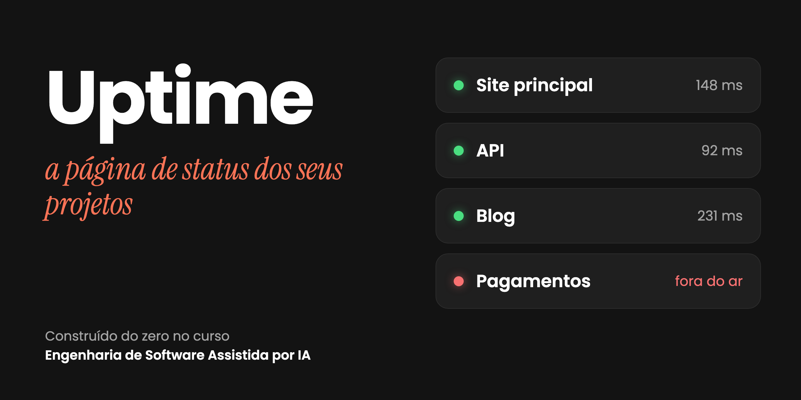

# Uptime

A página de status dos seus próprios projetos, como a do
[githubstatus.com](https://www.githubstatus.com/), mas hospedada por você: você cadastra os sites que
quer monitorar, o app checa se cada um está no ar e guarda quanto tempo ele levou para responder.

Feito com Elixir, Phoenix LiveView e Postgres.

## Parte de um curso

Este app é o projeto do curso **Engenharia de Software Assistida por IA**, do
[Clube de Builders](https://bergholz.com.br/clube?utm_source=github&utm_content=uptime). No curso, a
gente constrói o app inteiro com um agente de programação (Claude Code), do primeiro `mix phx.new` até
o deploy, e aprende o que dá para delegar ao agente e o que continua sendo seu: ler o plano, conferir o
diff, escrever o teste e decidir o que entra no projeto.

[](https://bergholz.com.br/clube?utm_source=github&utm_content=uptime)

O app evolui junto com as aulas, então ele ainda está em construção.

## Como acompanhar pelo histórico

Cada tag é o estado do projeto no fim de uma aula, e cada commit é uma mudança só:

| Tag | O que o projeto ganha |
|---|---|
| `aula-2-2` | App Phoenix gerado, com as versões do Erlang e do Elixir fixadas |
| `aula-2-3` | Página inicial trocada por uma página de status simples |
| `aula-2-5` | Cadastro de sites e checagem manual com o botão "Verificar agora" |
| `aula-2-6` | Área de admin com login por link no email, só para os emails da lista `ADMIN_EMAILS` |

Para ver o projeto como ele estava numa aula: `git checkout aula-2-5`.

## Como rodar

Você precisa de Erlang e Elixir (as versões estão no `.tool-versions`, e o [asdf](https://asdf-vm.com/)
instala com `asdf install`) e de um Postgres rodando em `localhost` com o usuário `postgres`.

```bash
mix setup
ADMIN_EMAILS="voce@exemplo.com" mix phx.server
```

Abra [localhost:4000](http://localhost:4000). Para entrar na área de admin, vá em
[/users/log-in](http://localhost:4000/users/log-in) com um email da lista. Em desenvolvimento o email
não sai de verdade: o link de acesso aparece na caixa de entrada de mentira, em
[/dev/mailbox](http://localhost:4000/dev/mailbox). Depois do login, os sites ficam em
[/sites](http://localhost:4000/sites).

Antes de qualquer commit, `mix precommit` compila, formata e roda os testes.
